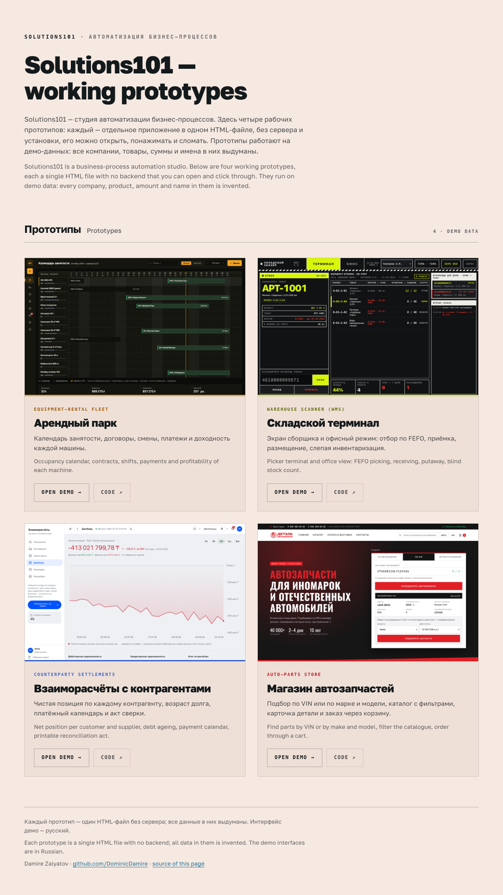
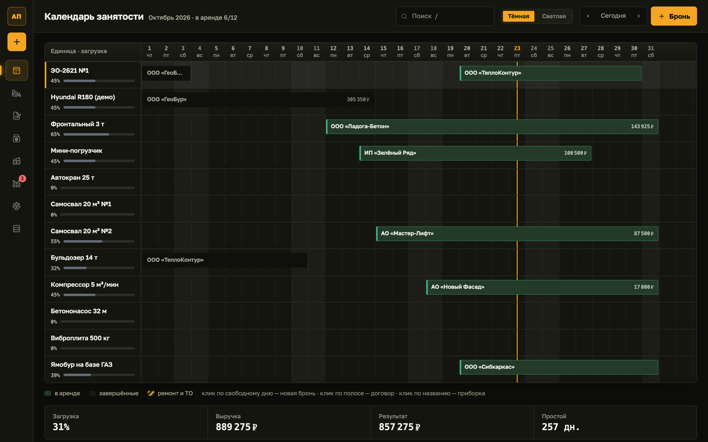
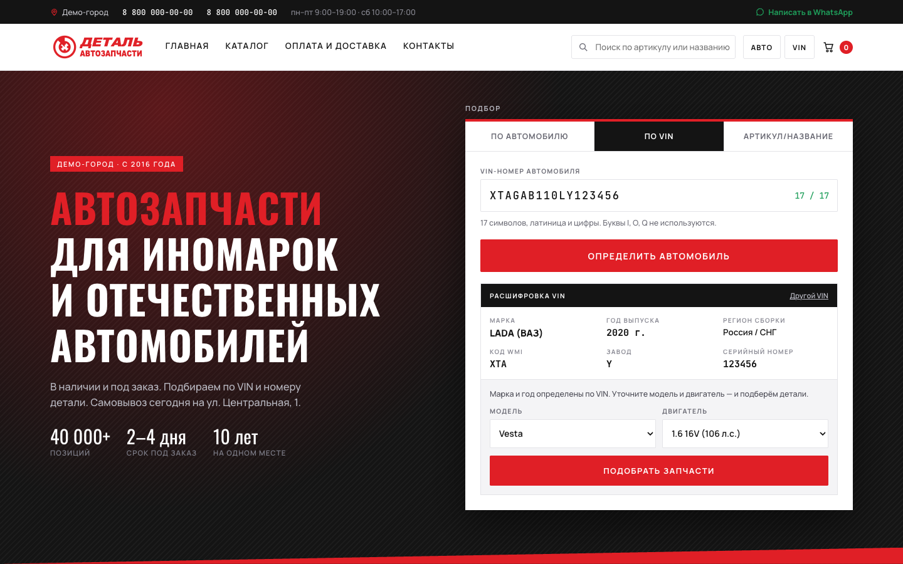
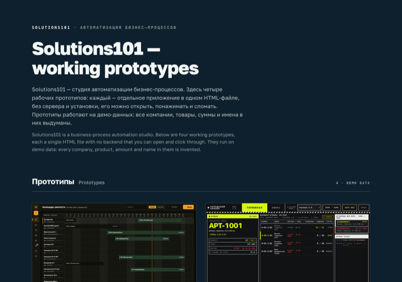
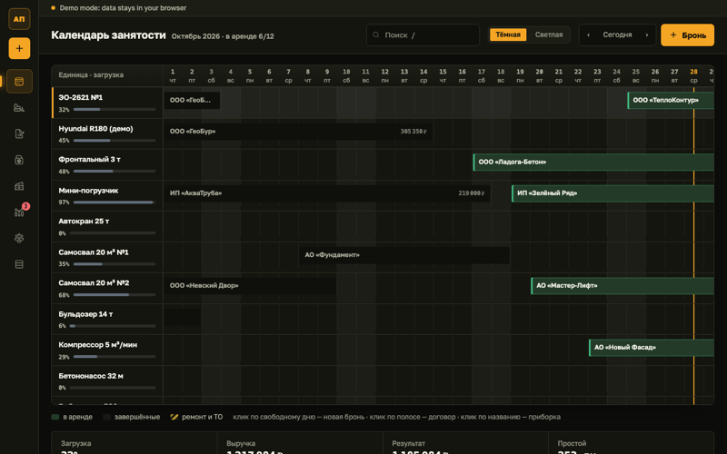
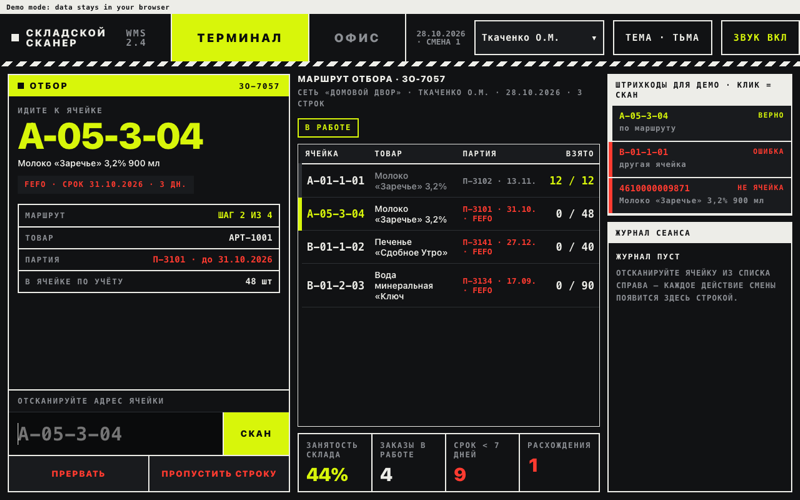
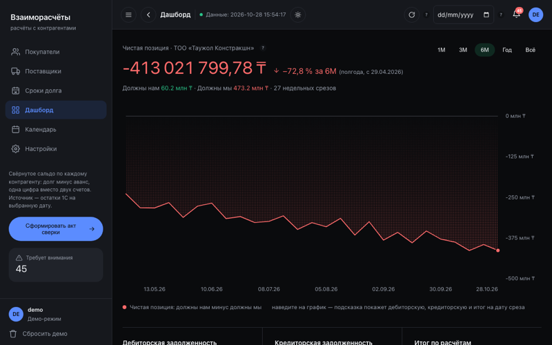
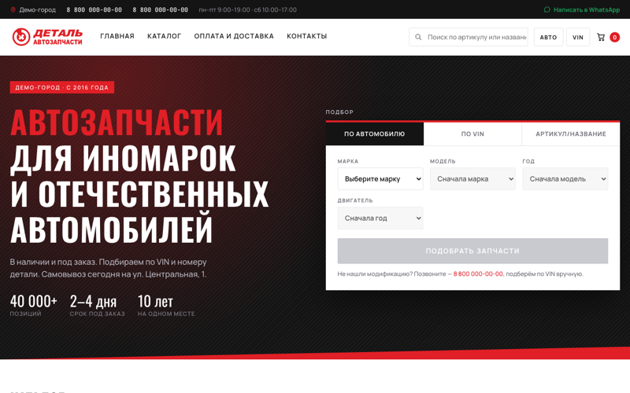

# Solutions101 — working prototypes (public demo)

> **Public demo repository.** It contains the built, runnable demos only (single-file HTML in browser `localStorage` mode, no server). **Source code, including the Python/SQLite backends, is private; available on request** (zalyatovdamiredominic@gmail.com).

## The problem

Small businesses in the target market run rentals, warehouses, settlements and parts sales from paper, chat messages and spreadsheets. Solutions101 is a studio that turns one such process at a time into a working prototype before any custom build is priced. These are four of those prototypes.

Four working business-process-automation prototypes from the Solutions101 studio. Each is a single HTML file that runs in the browser on invented demo data, with no install.

**Sold to clients:** the settlements app only. Its production code is private; the public demo here uses invented data. **Pitched to a local business (not taken up):** the rental fleet, the warehouse terminal and the auto-parts store.

[](https://dominicdamire.github.io/solutions101-demo/)

**Live:** <https://dominicdamire.github.io/solutions101-demo/> (the index is in Russian with English subtitles; the demos have a Russian interface)

## What each does

| Prototype | What it does | Demo | Folder |
|---|---|---|---|
| **Equipment-rental fleet** («Арендный парк») | Occupancy calendar, contracts, shifts, payments and profitability of each machine. | [Open demo](https://dominicdamire.github.io/solutions101-demo/autopark/) | [autopark/](autopark) |
| **Warehouse scanner** («Складской терминал») | Picker terminal and office view: FEFO picking, receiving, putaway, moves, blind stock count. | [Open demo](https://dominicdamire.github.io/solutions101-demo/warehouse-terminal/) | [warehouse-terminal/](warehouse-terminal) |
| **Counterparty settlements** («Взаиморасчёты») | Net position per customer and supplier, debt ageing, payment calendar and a printable reconciliation act. | [Open demo](https://dominicdamire.github.io/solutions101-demo/accounting/) | [accounting/](accounting) |
| **Auto-parts store** («Магазин автозапчастей») | Find parts by VIN or by make and model, filter the catalogue, order through a cart. | [Open demo](https://dominicdamire.github.io/solutions101-demo/auto-parts/) | [auto-parts/](auto-parts) |

**Backends (private):** the rental fleet and the warehouse terminal each also have a Python/SQLite backend in the private source repository (login, roles, server-side overlap check or EAN-13 check, FEFO pick routing, transactional stock, audit log). The demos in this repository run without them, on invented data in `localStorage`.

| Autopark | Warehouse terminal |
|---|---|
| [](autopark) | [](warehouse-terminal) |
| **Accounting** | **Auto-parts** |
| [](accounting) | [](auto-parts) |

Each folder has its own README with screenshots and a short walkthrough.

## Screenshots

Captured from the live demo with headless Chrome (more per demo in each folder's `docs/`).

| | |
|---|---|
|  |  |
|  |  |
|  | |

## Demo data: all invented

All companies, people, goods, amounts, phone numbers and tax numbers in the demos are invented and generated in the browser. In demo mode nothing is sent anywhere; state lives in your browser's `localStorage`. With the optional backend, data goes only to your own server.

## Language

The demo interfaces are in Russian (the target market). This index page carries English subtitles.

## Tech

Plain HTML, CSS and JavaScript, one `index.html` per prototype, no build step. The warehouse terminal loads React 18 from cdnjs, so it needs a network connection on first load. Fonts: Golos Text and JetBrains Mono (SIL Open Font License).

| path | what |
|---|---|
| `index.html`, `assets/` | the index page, card screenshots and self-hosted fonts |
| `autopark/`, `warehouse-terminal/`, `accounting/`, `auto-parts/` | the four prototypes (each with its own README and screenshots) |
| `park.html`, `sklad.html`, `vzaimoraschety-v2.html`, `zapchasti.html` | small redirect pages that keep old links working |

## Run locally

```bash
git clone https://github.com/DominicDamire/solutions101-demo.git
cd solutions101-demo
python3 -m http.server 8000
```

Open <http://localhost:8000>.

## Tests

Counts from the private source repository's test files (not re-run for this page): the rental-fleet backend suite has 59 `unittest` test functions and the warehouse-terminal backend suite has 58, run in the source repository's GitHub Actions after `ruff format --check`, `ruff check` and `mypy`. The static pages in this repository have no automated tests; they were checked by opening them in a browser at desktop and phone width.

## Status / limits

Demonstration prototypes with generated data: no backend, no accounts, nothing is sent anywhere. Not production systems; the settlements app was sold to a client and its production code is separate and private.

---

Author: Damire Zalyatov
