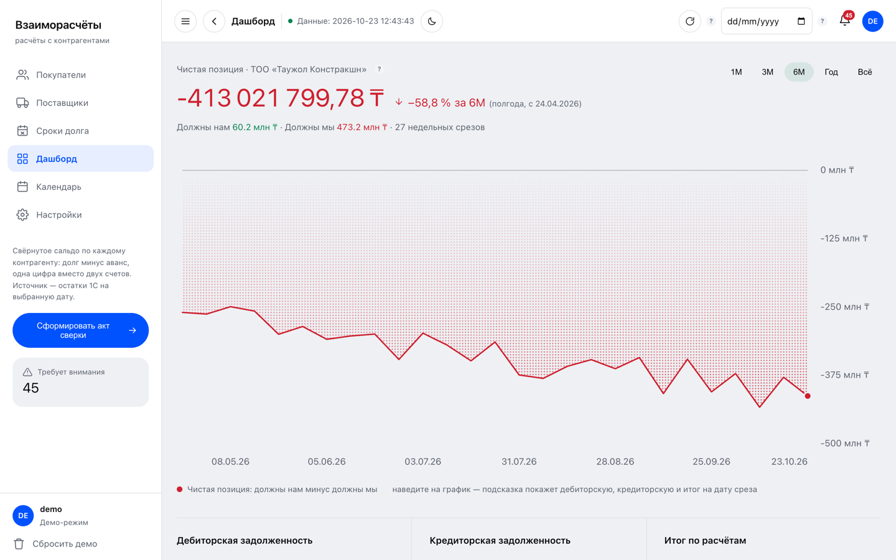
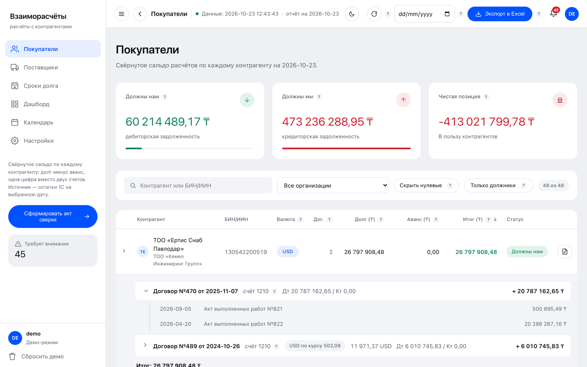
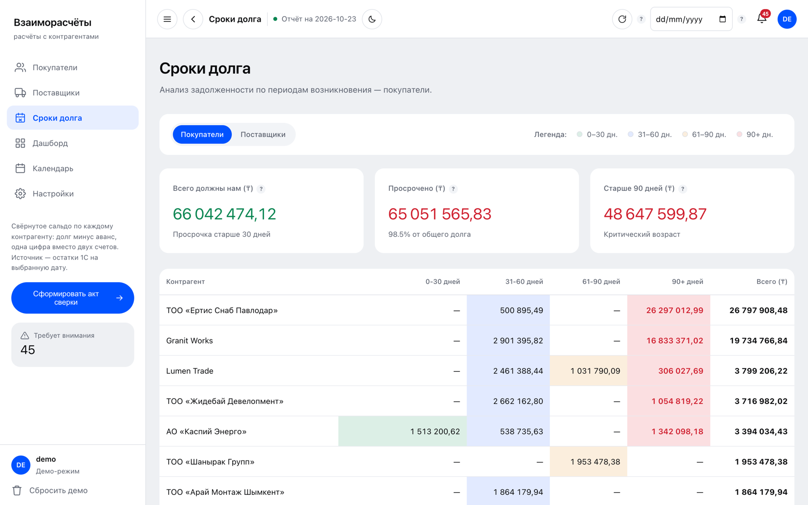
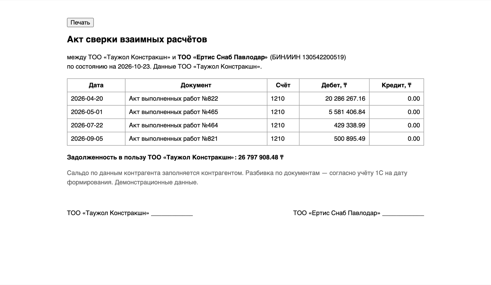
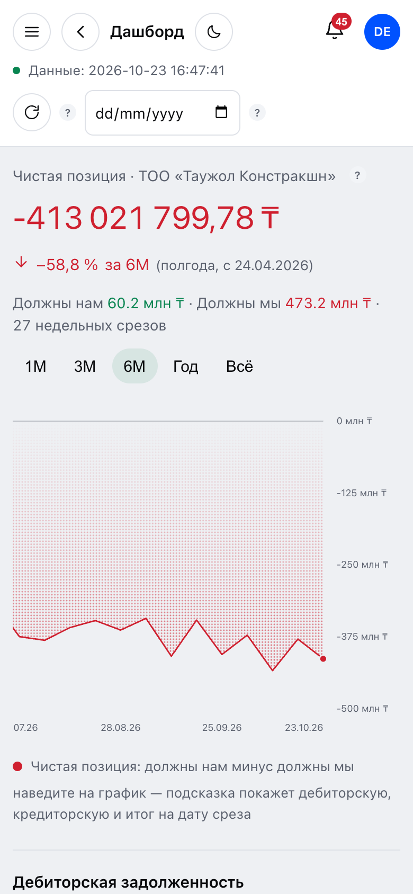
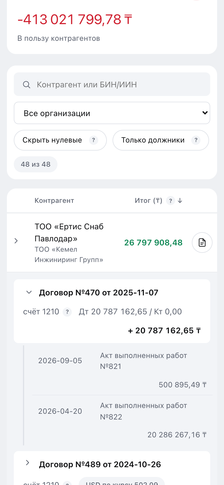

# Accounting — counterparty settlements

A single-page accounting prototype ("Взаиморасчёты с контрагентами") that shows, for every customer and supplier, who owes whom: one net position per counterparty, receivables and payables, debt ageing, a payment calendar and a printable reconciliation act.



**Live demo: https://dominicdamire.github.io/solutions101-demo/accounting/**

## What it does

- **Net position per counterparty.** Debt minus advance as one signed number, with a status (they owe us / we owe them / closed). Customers: account 1210 (receivable) minus 3510 (advance received). Suppliers: 3310 (payable) minus 1710 (advance paid). Uses the Kazakhstan chart of accounts.
- **Customers and Suppliers reports.** Search by name or BIN/IIN, filter by legal entity (three entities), hide zero balances, debtors only, sortable columns, totals row. Each row expands into contracts and, one level deeper, the settlement documents; foreign-currency contracts are converted to KZT at a per-date rate.
- **Excel export.** CSV (`;` separator, BOM) of the current report with the active search, filters and date applied.
- **Dashboard.** Net position with the change over the chosen period (1М / 3М / 6М / Год / Всё) on a weekly series, receivables and payables blocks, top debtors (customers, suppliers or both) and an attention list of overdue documents.
- **Debt ageing.** Per counterparty: 0–30, 31–60, 61–90 and 90+ days, overdue share and the oldest part of the debt.
- **Calendar.** Expected receipts and payments by document due date (document date + 30 days), split into overdue and upcoming, with direction arrows.
- **Reconciliation act.** A printable "Акт сверки взаимных расчётов" per counterparty, built for the selected report date: documents with debit and credit, the balance and signature lines. It opens in a new tab.
- **Account rules.** A settings table decides which accounts feed each report, with which sign and on which side (debt, advance, offset); rules can be added, edited, switched off or deleted, and every report recalculates. The offset rule ("покупатель = поставщик") is off by default.
- **Notifications and extras.** Overdue documents and position sign changes against the previous week, any report date, light and dark theme, collapsible sidebar, and a phone layout (below 700 px the sidebar becomes a drawer opened with the burger button).

| Customers (row expanded) | Debt ageing |
| --- | --- |
|  |  |



On a phone (below 700 px) the menu becomes a drawer, the report keeps the counterparty, the total and the act icon (the rest is in the expanded row), and the chart scrolls inside its card:

| Dashboard | Menu | Customers (row expanded) |
| --- | --- | --- |
|  |  |  |

## How to use the demo

1. Open the dashboard (start screen) and switch the chart period with **1М**, **3М** or **Год**: the delta and the weekly series change.
2. Click **Покупатели** in the left menu (on a phone, open the menu with the burger button first), then click any counterparty row to see its contracts; click a contract to see its documents.
3. Click **Сформировать акт сверки** in the left menu, then the document icon at the end of a row: the reconciliation act opens in a new tab.
4. In **Настройки**, switch an account rule on or off (for example the 3310 offset rule): the reports recalculate. **Сбросить демо** restores the defaults.

## Tech

One `index.html` (~122 KB): HTML, CSS and vanilla JavaScript, no build step, no dependencies, no network requests. The dataset and the calculation engine are embedded in the page; contracts, documents, rates and the weekly history are derived deterministically from each counterparty's BIN and the report date. Rules, theme and sidebar state are kept in `localStorage`; the chart and icons are inline SVG.

## Run locally

```sh
python3 -m http.server
# open http://localhost:8000/
```

## Demo data

All companies, people, BIN/IIN numbers and amounts are invented. The BIN/IIN values are random 12-digit numbers with an intentionally wrong check digit, so none of them can belong to a real entity.

Limits: this is a prototype with an embedded dataset, not a connection to a real ledger.

---

Part of **Solutions101** — business process automation by Damire Zalyatov · [github.com/DominicDamire](https://github.com/DominicDamire)

## History

Developed in a private repository and published here in October 2026.
