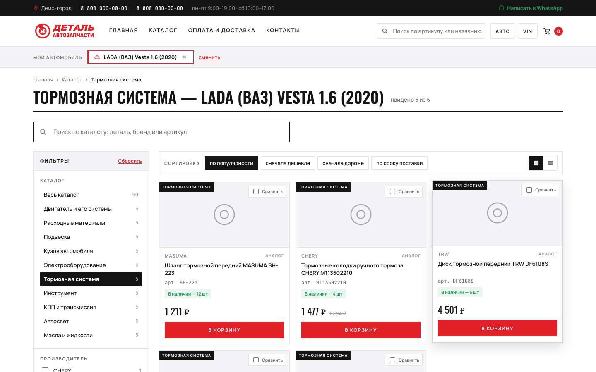
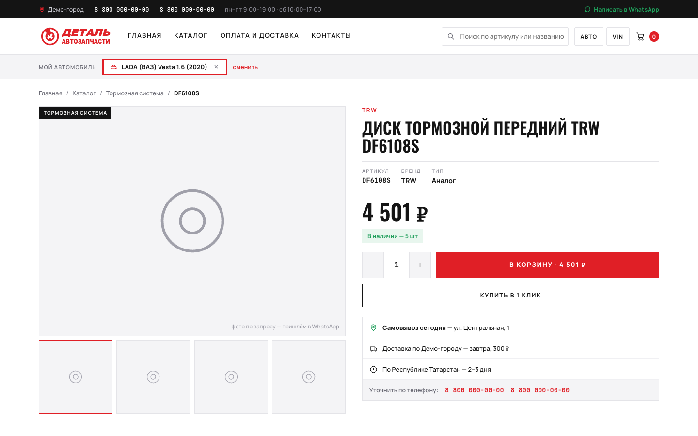
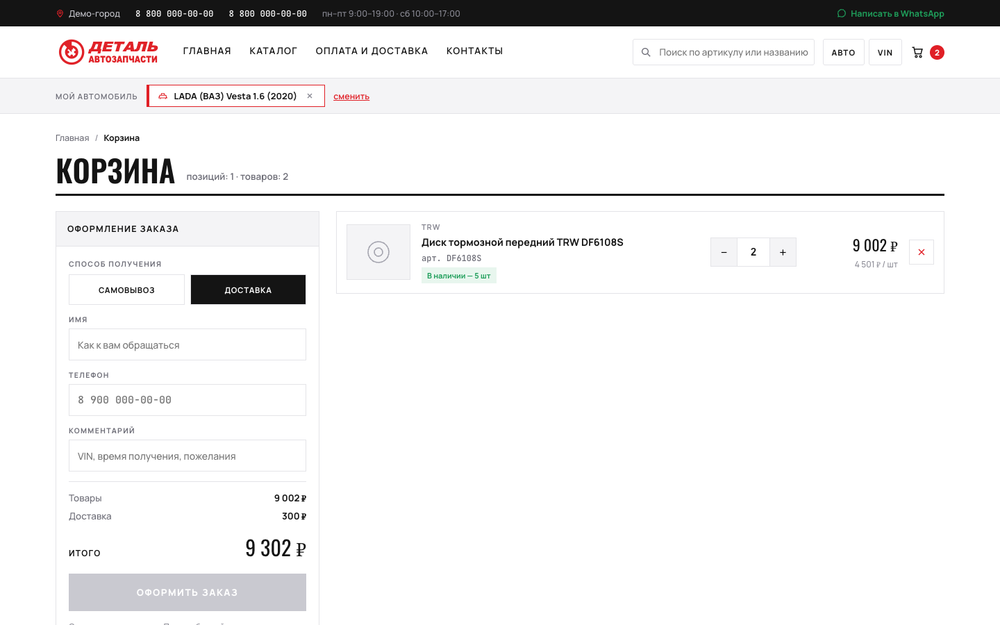
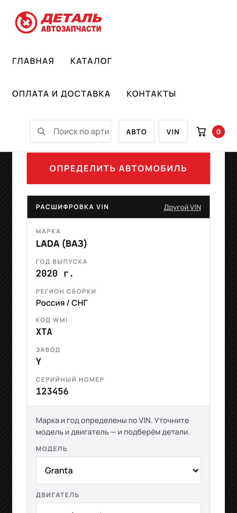

# Auto-parts store — Solutions101 demo

Find car parts by VIN or by make and model, filter a catalogue, open a part and order it through a cart. A single HTML file with invented shop data and no backend.


**[Live demo](https://dominicdamire.github.io/solutions101-demo/auto-parts/)** (the interface is in Russian)

<table>
  <tr>
    <td></td>
    <td></td>
  </tr>
  <tr>
    <td align="center">Catalogue with filters and sorting</td>
    <td align="center">Part page</td>
  </tr>
  <tr>
    <td></td>
    <td></td>
  </tr>
  <tr>
    <td align="center">Cart and order form</td>
    <td align="center">Phone layout (390 px)</td>
  </tr>
</table>

## What it does

A small online store for car parts, in Russian. Everything runs in the browser tab.

- **Three ways to search** on the home page: by car (make → model → year → engine; 25 makes, 74 models), by VIN, and by part number or name.
- **VIN decoding.** A 17-character VIN is split into the manufacturer code (looked up in a 165-entry table, with a two-character fallback), the model year (10th character), the assembly region (1st character), the plant code and the serial number. The make and year come from the VIN; you then pick the model and engine.
- **Catalogue.** 10 categories with filters (manufacturer, availability, installation side, subcategory, warranty, original or analogue), a price slider, four sort orders, grid or list view and "show more" in steps of 12. The search box suggests parts while you type and offers a "did you mean" hint for typos.
- **Chosen car.** A "my car" chip stays under the header. Parts whose fitment list includes the chosen make get a green **Подходит к вашему авто** ("fits your car") mark. The part page has specifications, a fitment table, a description, analogues, reviews and related parts.
- **Cart and order.** A quantity stepper (1–99) on the part page; in the cart every line has **−** / **+** and remove, and the order is pickup (free) or delivery (+300 ₽). The order button unlocks once a name and a phone number with at least 10 digits are filled in; the confirmation screen shows an order number.

Limits of the demo, stated plainly:

- The data behind search, filters and part pages is 50 sample parts (5 per category). The "40 000+" headline and the per-category counters on the home page (they sum to 40,004) are static numbers.
- The price slider stops at 14,000 ₽, so the three sample parts priced above that (28,015–248,060 ₽) never show up in the catalogue list.
- Parts have no photos, only a placeholder.
- Nothing is sent or stored: the order confirmation is generated in the page and a reload empties the cart.
- **Купить в 1 клик** ("buy in 1 click") has no action, and the **Сравнить** ("compare") checkbox on the cards has no compare page behind it.

## How to use the demo

1. Open the [live demo](https://dominicdamire.github.io/solutions101-demo/auto-parts/) and click the **По VIN** tab. Enter a 17-character VIN such as `XTAGAB110LY123456`, press **Определить автомобиль**, choose a model and an engine, then press **Подобрать запчасти**. (The **По автомобилю** tab does the same with make → model → year → engine.)
2. In the catalogue use the filters and sort buttons, or type a part name in the search box, and click a part to open it.
3. Set the quantity with **−** / **+** and press **В корзину** ("add to cart").
4. Open the cart (icon at the top right), change the quantities, pick pickup or delivery, fill in a name and a phone number and press **Оформить заказ** ("place the order").

## Tech

One file, `index.html` (about 970 KB), no build step. The page is an `<x-dc>` HTML template plus a `text/x-dc` class script that holds the logic and the catalogue data. A small runtime embedded at the top of the file (a generated bundle, kept as it was exported) renders it with React 18.3.1 and ReactDOM loaded from cdnjs with SRI hashes; those two scripts are the only network requests besides the page itself, so the demo needs internet access. Fonts (Manrope, Oswald, JetBrains Mono) are embedded as base64 woff2, and the logo and icons are inline SVG. VIN decoding, search, filtering and the cart all run in the browser.

## Run locally

```sh
git clone https://github.com/DominicDamire/solutions101-demo.git
cd solutions101/auto-parts
python3 -m http.server
```

Then open <http://localhost:8000/>.

## Demo data

The shop, its address, phone numbers, requisites and customer reviews are demo content: the shop is «Деталь» in "Демо-город", the phones are `8 800 000-00-00`, and the requisites are placeholders — sole proprietor «ИП Демо», INN `000000000000`, OGRNIP `000000000000000`, postcode `000000`. The 50 sample parts carry real manufacturer names and article numbers, as a parts catalogue does; their prices and stock levels are demo values. The page itself is labelled «демонстрационный магазин» ("demo store").

---

Part of Solutions101 — business process automation by Damire Zalyatov · [github.com/DominicDamire](https://github.com/DominicDamire)

## History

Developed in a private repository and published here in October 2026.
