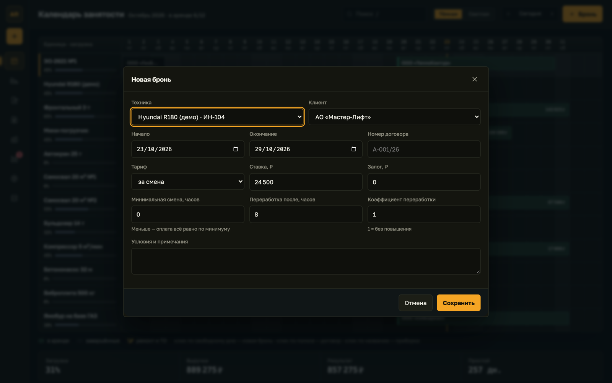
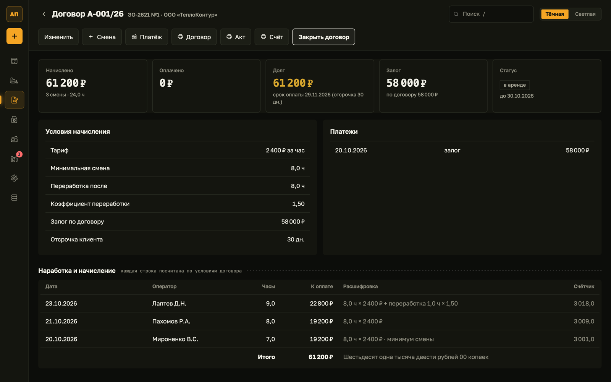
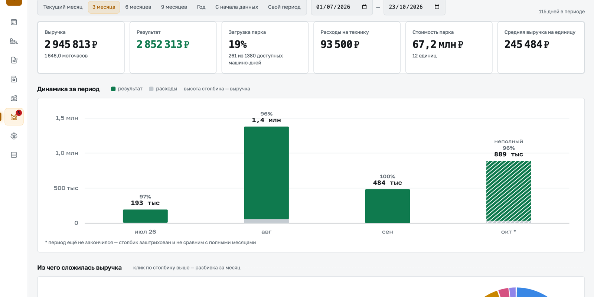

# Autopark — equipment-rental fleet system

Occupancy calendar, contracts, shifts, payments and per-machine profitability for a fleet of construction equipment, as a single HTML file with a Russian interface that runs entirely in the browser.


**Live demo:** <https://dominicdamire.github.io/solutions101-demo/autopark/> (interface language: Russian)

## What it does

The main screen is **«Календарь занятости»**: one row per machine, one bar per contract across the visible month, hatched days for repair and service, a line for today and a load percentage per machine. Under the grid: load, revenue, result and idle days for the month, and a dashboard («Приборная панель») for the selected machine (hours worked, load, revenue, result, costs, idle days, service warning).

- **Bookings.** Click a free day on a machine's row to open «Новая бронь»: machine, client, dates, tariff per hour / shift / day, rate, deposit, minimum shift, overtime threshold and multiplier. A booking that overlaps another contract on the same machine is refused; the form links to the conflicting contract and offers the first free date.
- **Contracts.** A list with filters («Все», «Действующие», «Просрочка», «Закрытые»). A contract screen shows accrued, paid, debt, deposit and status, plus every shift with the formula behind its amount and the total in words. Closing a contract settles the deposit (hold with a reason, refund of the rest). «Договор», «Акт» and «Счёт» open as printable A4 documents (print or save as PDF from the browser); the landlord's requisites come from the «Данные» screen.
- **Shifts («Наработка»).** Quick entry of hours per contract and day with the operator; accrual follows the contract terms (minimum shift, overtime after N hours at a multiplier).
- **Money («Деньги»).** Accrued, paid, debt and overdue amounts, receivables by client, deposits held, and payments of three kinds: rent, deposit, deposit refund.
- **Fleet profitability («Парк») and analytics («Аналитика»).** Period presets, revenue / expenses / result by day, week or month, revenue by machine type with drill-down, a machine × period utilisation heat-map, a ranking of machines, payback against purchase cost, and a «Требует внимания» list (overdue payments, service due or overdue by engine hours, negative return, contracts left open, no hours entered, invalid ИНН).
- **Clients, machines, data.** Clients with ИНН check-digit validation and payment deferral. A machine card with its economics and service schedule. Export of the whole database to JSON, validated import, a CSV of contracts for Excel, regenerate or wipe the demo data.
- **Details.** Dark and light themes, `Ctrl/Cmd+Z` undoes the last delete, `/` focuses search, deep links such as `?view=analytics&period=m6`.

## How to use the demo

1. Open the live demo. The first visit generates demo data in your browser: 12 machines, 18 clients, 150 contracts over about two years.
2. On the calendar, click an empty day on any machine row, pick a client and press «Сохранить». Try dates that overlap an existing bar to see the refusal.
3. Click a contract bar to open the contract; use «Договор», «Акт» or «Счёт» to see the printable documents. Click a machine name to fill the dashboard below the calendar, then «Карточка единицы» for its full card.
4. Switch «Тёмная» / «Светлая» in the header, and open «Аналитика» from the left rail.







## Tech

Plain HTML, CSS and JavaScript in one file (`index.html`, about 330 KB): no build step, no dependencies, no network requests. State is kept in the browser's `localStorage` (`arendapark` for the data, `park.theme` for the theme). The charts are hand-written SVG. Fonts (Golos Text, JetBrains Mono; SIL Open Font License) are embedded as base64 WOFF2; the icons are [Icons8](https://icons8.com) Material Outlined, inlined as SVG paths. By default there is no backend and no accounts. An optional Python/SQLite backend lives in [`server/`](server): when `index.html` is served by it, the page signs in and keeps all data on the server instead (see [`server/README.md`](server/README.md)). Opened statically, the page stays in this browser-only demo mode.

## Run locally

```bash
git clone https://github.com/DominicDamire/solutions101-demo.git
cd solutions101/autopark
python3 -m http.server 8000
```

Open <http://localhost:8000>.

## Demo data

All companies, people, phone numbers and tax numbers are invented. They are generated in the browser from a fixed seed, with dates relative to today; the client ИНН values are random numbers with valid check digits, and one is deliberately invalid to show the validation. «Данные → Удалить демо-данные» and «Очистить всё» remove them from your browser.

---

Part of **Solutions101** — business process automation by Damire Zalyatov · <https://github.com/DominicDamire>

## History

Developed in a private repository and published here in October 2026.
