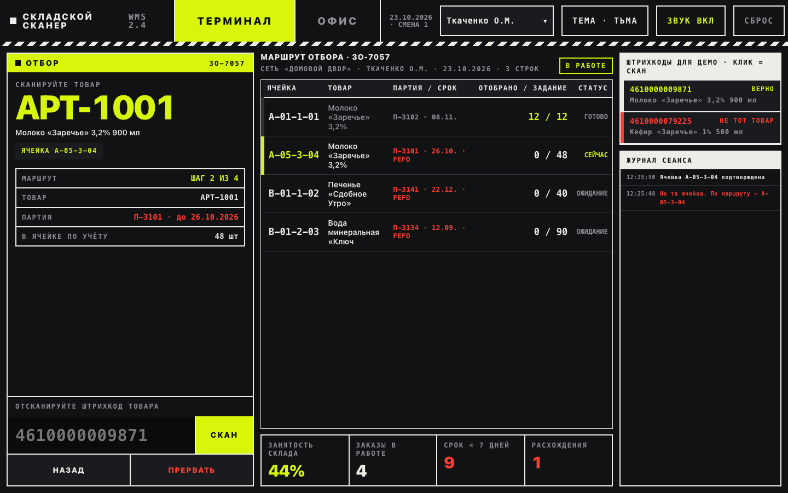
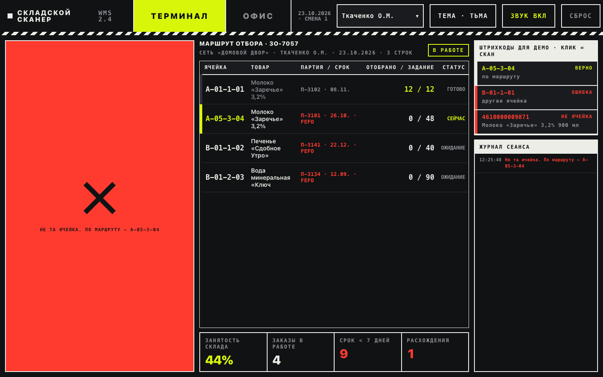
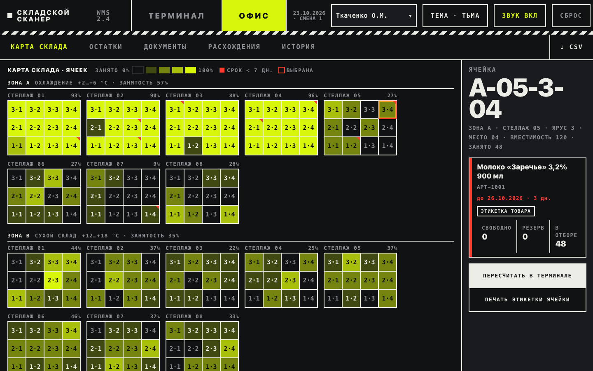
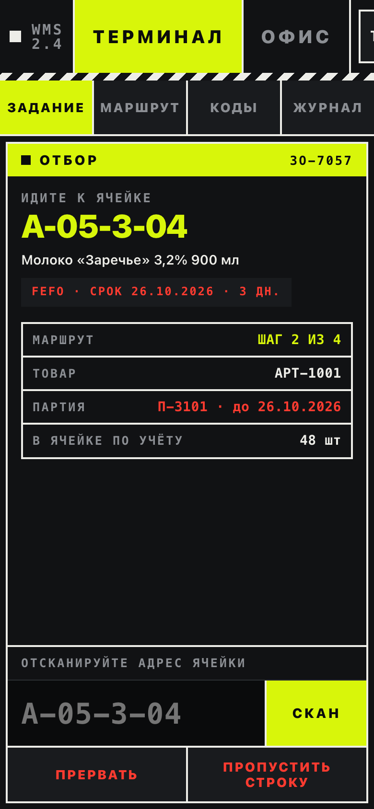

# Warehouse Terminal — «Складской сканер WMS 2.4»

A handheld warehouse-scanner screen and an office back-office view in one HTML file: picking routes with FEFO batches, cell and barcode scanning, receiving, putaway, moves and blind stock counts, running entirely in the browser on invented data (demo mode), or on the bundled Python/SQLite backend (server mode).



**Live demo:** <https://dominicdamire.github.io/solutions101-demo/warehouse-terminal/> (interface language: Russian)

## What it does

The demo simulates one shift of a food and household-goods warehouse: 290 storage cells (zones A cooled, B dry, C non-food, 96 cells each) plus a receiving buffer `ПР-01` and a shipping buffer `ОТ-01`, 124 products in 15 categories, 136 batches with expiry dates, 170 orders and 60 receipts with their movement history. Two modes work on the same data set.

**Terminal** is the picker's scanner screen: one action per step, a large address, a numpad, a red/green flash on every scan and a session log.

- **Picking (Отбор)** — orders are queued by priority and shipping date. Starting an order builds a route: each line is taken from the batch that expires first (FEFO), split across cells if one cell is not enough, and sorted along the racks. For every step the picker scans the cell, scans the product barcode and enters the quantity. A wrong cell, a wrong product or too large a quantity is rejected with an error. If the picker finds less than the task, the rest is added as a top-up line from another cell, or the line is closed short when there is no stock left.
- **Receiving (Приёмка)** — scan the products of an incoming order and enter the quantity; goods go to the receiving buffer. A line or the whole order can be closed with a discrepancy, which then shows up in the office.
- **Putaway (Размещение)** — scan an item from the buffer; the terminal suggests a free cell in the product's own zone nearest to receiving and shows why. The picker confirms or scans another cell; zone, mixed-product and capacity rules are checked.
- **Move (Перемещение)** — source cell, position, quantity, destination cell; an empty source, a quantity above the free stock, a foreign product in the destination and an overfull cell are rejected.
- **Inventory count (Инвентаризация)** — scan a cell and enter the counted quantity per position while the book quantity stays hidden; the result is an act with the differences, and applying it corrects the stock.

**Office** has five tabs: the warehouse map (occupancy per cell by rack and zone, a marker for batches that expire within 7 days, a card with batches, reserved and in-picking quantities, label printing), stock by cell with search, documents (pick sheets, receiving orders, inventory acts, each with a printable form), discrepancies, and the movement history. Cell and product labels with EAN-13 and Code 128 barcodes, drawn by the page, can be opened for printing. The current table exports to CSV.

Also in the header: staff selector, light/dark/auto theme, sound on/off, and **СБРОС**, which regenerates the demo data.







## How to use the demo

1. Open the live demo. The terminal is in the middle of pick order ЗО-7057: step 2 of 4 asks for cell `A-05-3-04`, a milk batch that expires in a few days (FEFO).
2. In the right-hand panel **ШТРИХКОДЫ ДЛЯ ДЕМО · КЛИК = СКАН** click the red code (wrong cell) to see the error, then the green one to confirm the cell. The panel offers a correct code, wrong codes and, at the quantity step, `48` (full), `88` (too many) and `43` (short pick that adds a top-up line). Typing a code and pressing Enter works the same way, as with a hardware scanner.
3. Open **ОФИС**: the map and the stock show the picked quantity gone, the history tab lists the movement, and a document or label can be opened for printing.
4. Press **СБРОС** to regenerate the data and start again.

## Tech

One `index.html`, plain HTML, CSS and JavaScript, no build step. Opened statically (GitHub Pages, `python3 -m http.server`) it needs no backend and no accounts: demo mode, shown with a small banner. Served by `server/server.py` it detects `GET /api/health`, asks for a login and works on the real backend instead; see [server/README.md](server/README.md). The page embeds a small component runtime that compiles the template and logic class in the browser and loads React 18.3.1 and ReactDOM from cdnjs, so the first load needs an internet connection. Barcodes (EAN-13 and Code 128 B) and the sound signals are generated in the page. The state is kept in the browser's `localStorage` (`sklad_scanner_v1`).

## Run locally

```bash
git clone https://github.com/DominicDamire/solutions101-demo.git
cd solutions101/warehouse-terminal
python3 -m http.server 8000
```

Open <http://localhost:8000>.

## Demo data

All companies, people, products, addresses and numbers in the demo are invented. Dates in the data are generated relative to the current day.

---

Part of **Solutions101** — business process automation by Damire Zalyatov · <https://github.com/DominicDamire>

## History

Developed in a private repository and published here in October 2026.
